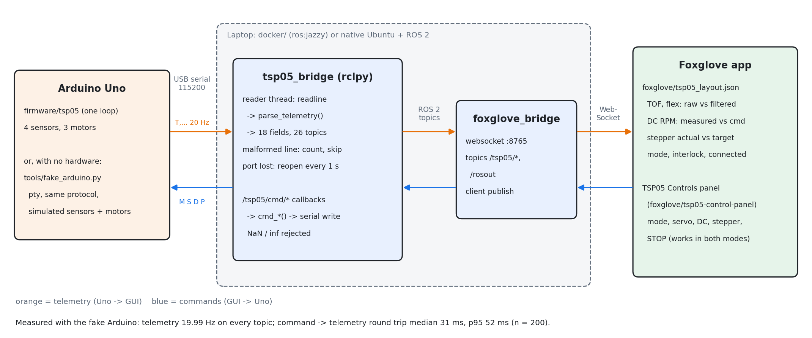
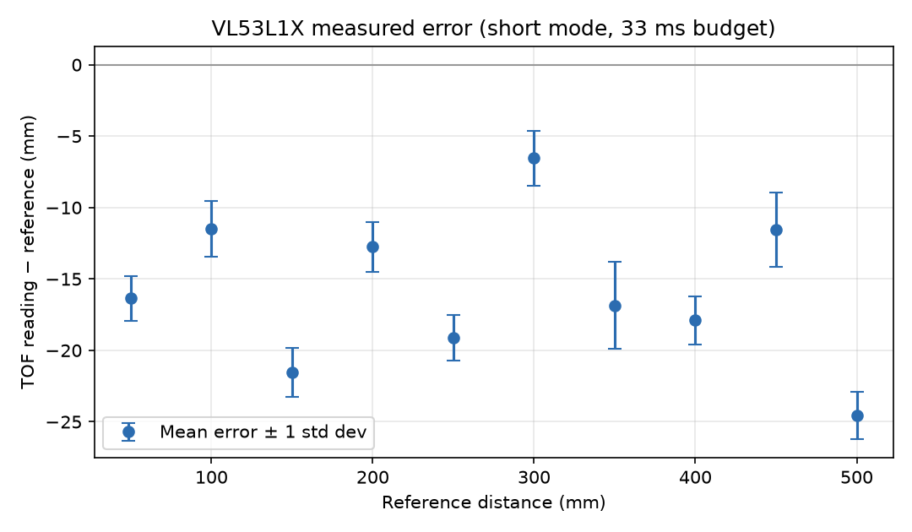
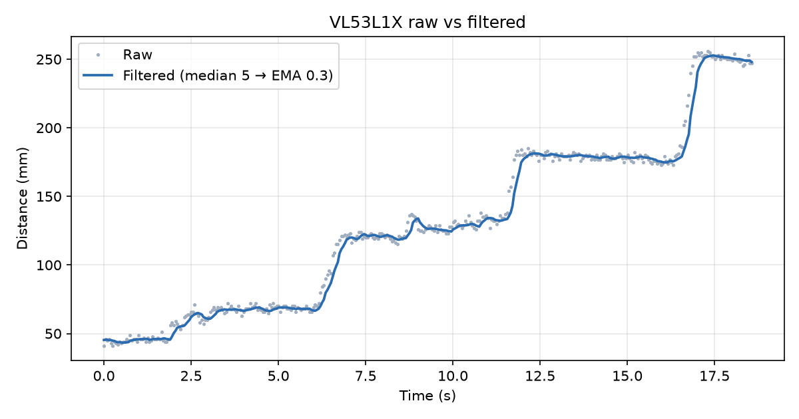
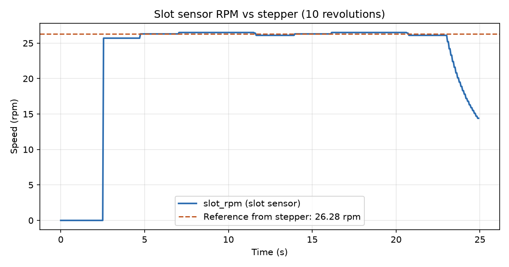

# TSP05: Sensors & Motor Control

16-650 Systems Engineering. An Arduino Uno reads four sensors and drives three motors, with state and control exposed through ROS 2 and a Foxglove GUI.

## System Overview
<!-- Block diagram: docs/figures/block_diagram.png -->

| Sensor | Physical output | Controls |
|---|---|---|
| VL53L1X TOF | Distance (mm) | Servo angle |
| Flex/bend sensor (Adafruit 182) | Bend angle (deg) | DC motor velocity |
| Omron EE-SX1042 slot sensor | Event count, RPM | Stepper jog per event |
| 10k thermistor | Temperature (degC) | DC motor thermal interlock |

Control mode (GUI or SENSOR) is toggled by the debounced pushbutton or from the GUI.

## Hardware
- [Pin map and power](docs/pinmap.md)
- Wiring diagram: <!-- docs/figures/wiring.png -->

## Software
- Firmware: `firmware/tsp05/`
- ROS 2 bridge: `ros2_ws/src/tsp05_bridge/` (serial <-> `/tsp05/*` topics, launch file, tests)
- Foxglove layout: `foxglove/tsp05_layout.json`; command panel: `foxglove/tsp05-control-panel/`
- Fake Arduino (no hardware needed): `tools/fake_arduino.py`
- ROS 2 dev container: `docker/`
- [Serial protocol](docs/protocol.md)

## Running
<!-- Build/flash steps: Track 2 -->

### ROS 2 bridge + Foxglove
The laptop side runs either in Docker (any OS) or natively on Ubuntu with ROS 2
Humble or Jazzy. Both use the same code.

**Docker** (macOS, Windows, or Linux; needs Docker Desktop / Docker Engine):

    docker/run.sh ros2 launch tsp05_bridge tsp05.launch.py fake:=true   # no hardware
    docker/test.sh                                                     # build + all tests
    ROS_DISTRO=humble docker/run.sh                                    # Humble image instead of Jazzy

With the real Uno on a Linux host, pass the device in:

    TSP05_SERIAL_DEVICE=/dev/ttyACM0 docker/run.sh ros2 launch tsp05_bridge tsp05.launch.py port:=/dev/ttyACM0

**Real Uno on macOS.** Docker Desktop on macOS cannot pass USB devices to a
container, so `tools/uno_relay.sh` shares the Uno's port over TCP on the Mac and
the bridge connects to it. One-time setup: `brew install socat`. A genuine Uno
needs no driver and shows up as `/dev/cu.usbmodem*`; CH340 clones show up as
`/dev/cu.usbserial-*`. Close the Arduino Serial Monitor first, since only one
program can hold the port.

    tools/uno_relay.sh                     # terminal 1: finds the Uno, listens on 127.0.0.1:7777
    docker/run.sh ros2 launch tsp05_bridge tsp05.launch.py port:=socket://host.docker.internal:7777   # terminal 2

The bridge log should show `connected to socket://host.docker.internal:7777`,
then `telemetry 20.0 Hz, 0 malformed` every 10 s. Opening the port resets the
Uno, so the first 10 s window reads low (about 17 Hz) and may count a few
malformed lines cut by the reset; that is expected.

Notes on the relay: port 7777, because macOS's AirPlay Receiver already
listens on 7000. socat 1.8 on macOS needs `ispeed=115200,ospeed=115200` (it
rejects `b115200`). `fork` lets the bridge reconnect after a restart.
Measured on the Uno through this relay: 19.9-20.0 Hz, 0 malformed after the
first window; servo command to telemetry 24-58 ms.

**Native Ubuntu** (ROS 2 sourced):

    sudo apt install ros-$ROS_DISTRO-foxglove-bridge python3-serial
    sudo usermod -aG dialout $USER        # serial port access; log out and back in
    cd ros2_ws && colcon build && source install/setup.bash
    ros2 launch tsp05_bridge tsp05.launch.py port:=/dev/ttyACM0     # or fake:=true
    colcon test && colcon test-result --verbose

**Foxglove**
1. Foxglove desktop app: Open connection -> Foxglove WebSocket -> `ws://localhost:8765`.
2. Layout -> Import from file -> `foxglove/tsp05_layout.json` (plots and indicators).
3. Command panel, once per machine (Node 18+):
   `cd foxglove/tsp05-control-panel && npm ci && npm run local-install`,
   restart Foxglove, then Add panel -> "TSP05 Controls".

Launch arguments: `port`, `baud` (115200), `fake`, `fake_link` (`/tmp/tsp05`),
`foxglove`, `foxglove_port` (8765). Topics are listed in
`ros2_ws/src/tsp05_bridge/tsp05_bridge/topics.py`; they follow the team guide
with `fsr/*` renamed to `flex/*`.

**Feedback topics.** The firmware does not report the DC target, arrival, a
frozen TOF, or whether a command was obeyed, so the bridge works them out from
the commands it sends and the telemetry (`tsp05_bridge/feedback.py`; thresholds
are ROS parameters with defaults from `config.h`):

| Topic | Type | Meaning |
|---|---|---|
| `/tsp05/dc/mode` | Int8 | DC controller mode: 0 idle, 1 velocity, 2 position |
| `/tsp05/dc/target` | Float32 | position mode: target deg (dc_deg when sent + move); velocity mode: target rpm; idle: 0 |
| `/tsp05/dc/arrived` | Bool | position mode and within 2 deg of the target (flickers if the motor coasts through) |
| `/tsp05/dc/settled` | Bool | arrived and below 2 rpm for 5 lines in a row: what the GUI calls "arrived" |
| `/tsp05/tof/fault` | Bool | TOF reading still 0 or unchanged for 500 ms (no valid range: values are frozen) |
| `/tsp05/cmd/status` | String | per command: `applied in N ms`, `ignored (SENSOR mode)`, `ignored (interlock)`, or `no effect seen within 1 s` |
| `/tsp05/bridge/rate_hz`, `/tsp05/bridge/line_age_ms` | Float32 | telemetry rate and time since the last line |
| `/tsp05/interlock/threshold_c` | Float32 | interlock threshold (30 C), for a limit line on the temperature plot |

## Calibration Results
<!-- Transfer function plot, filtering plot, error table per sensor -->

### TOF (VL53L1X) and slot sensor (Track 3)
Raw (unfiltered) TOF readings, status 0 only, target held square to the sensor;
20 samples per distance over 50-500 mm, which covers the 50-400 mm TOF -> servo
mapping. Data: `calibration/data/tof_error.csv`, `tof_filter.csv`; tables
regenerated by `python tools/tof_calibration.py report` (`calibration/tof_results.md`).

| Reference (mm) | Mean reading (mm) | Error (mm) | Std dev (mm) |
|---|---|---|---|
| 50 | 33.6 | -16.4 | 1.6 |
| 100 | 88.5 | -11.5 | 1.9 |
| 150 | 128.4 | -21.6 | 1.7 |
| 200 | 187.2 | -12.8 | 1.7 |
| 250 | 230.9 | -19.1 | 1.6 |
| 300 | 293.4 | -6.6 | 1.9 |
| 350 | 333.1 | -16.9 | 3.1 |
| 400 | 382.1 | -17.9 | 1.7 |
| 450 | 438.4 | -11.6 | 2.6 |
| 500 | 475.4 | -24.6 | 1.7 |

Mean error -15.9 mm, RMS 16.7 mm, max |error| 24.6 mm, worst std dev 3.1 mm. A
linear fit gives reading = -14.0 + 0.993 x reference: the scale is right to 0.7 %
and the error is a constant offset. With a +15.9 mm offset correction the RMS error
would be 5.1 mm; the remaining +-5 mm scatter is larger than the sensor noise
(about 2 mm), so it is mostly placement of the hand-held target.

| Filter | Raw noise (mm) | Filtered noise (mm) | Reduction |
|---|---|---|---|
| median of 5 -> EMA alpha = 0.3 (firmware output) | 2.10 | 0.31 | 85 % |

Noise = per-sample standard deviation from the sample-to-sample change. Lag cost:
the median delays a step by about 80 ms, and the EMA adds a 112 ms time constant
(visible at each step above).

**Slot sensor**: 50 card passes at mixed speeds (about 15 slow, 20 normal, 15 fast)
counted exactly +50.

**Slot RPM vs stepper** (disc with 1 tab on the stepper shaft, `P,3600` = 10 revolutions,
`python tools/slot_rpm_check.py`): the reference is the stepper's own speed, the slope
of `step_deg` over time in telemetry, 26.28 rpm. `slot_rpm` read 26.1-26.5 rpm per
revolution (within +-0.25 rpm, +-1 %), mean 26.28 rpm; 10 events for 10 revolutions.
After the stop it decays smoothly rather than holding the last value.

## Individual Contributions
### <Name 1>
### <Name 2>
### Harish Bhamitipadi Magesh (Track 3: TOF + slot sensor)
- **TOF (VL53L1X, I2C)** (`firmware/tsp05/sensors_digital.cpp`): continuous ranging in
  short mode, 33 ms timing budget, 40 ms inter-measurement period (the sensor's 100 ms
  default would cap it at 10 Hz). Polled every 5 ms and read only when a range is ready,
  so `loop()` never waits. I2C at 400 kHz with a Wire timeout, so a glitched bus cannot
  hang the loop. Only status-0 ranges are used; `tofFault()` is raised after 500 ms
  without one.
- **Filter**: median of 5 (removes single-sample outliers), then EMA with alpha = 0.3.
  Lag cost: the median delays a step by about 80 ms, and the EMA adds a 112 ms time constant.
- **Slot sensor (EE-SX1042, D3 / INT1)**: RISING-edge interrupt with a 1 ms glitch
  filter; edges are time-stamped into a ring buffer. `slotTakeEvents()` hands each event
  to the stepper jog exactly once.
- **RPM**: period method over one full revolution (`SLOT_TABS` tabs; the final disc has
  1). Counting events in a 100 ms window would resolve only 150 RPM per count with 4
  tabs (600 with 1). Spanning a whole revolution also cancels unevenly cut tabs. RPM
  decays smoothly when the disc slows and reads 0 after `SLOT_TIMEOUT_MS` (5 s).
- **Integration**: the full `tsp05.ino` with this module uses 52 % flash and 45 % RAM
  (team limit 75 %).
- **Tools and tests**: bring-up sketch (`firmware/bringup/digital/`);
  `tools/tof_calibration.py` (error logging, raw-vs-filtered recording, error table and
  plots, `--sim` rehearsal); `tools/slot_rpm_check.py` (RPM against the stepper); host tests (`firmware/tests/test_sensors_digital.cpp`,
  37 checks) for the filter, faults, glitch filter, and RPM with uneven tabs.
- **Measured on hardware** (details under Calibration Results): TOF error over
  50-500 mm is a constant -15.9 mm offset (RMS 16.7 mm, std <= 3.1 mm, fit slope
  0.993; 5.1 mm RMS after offset correction). Filter on firmware output: noise
  2.10 -> 0.31 mm (85 %). Slot sensor: 50 passes -> exactly +50. Found and fixed
  telemetry running at 1 Hz instead of 20 Hz (`TELEMETRY_PERIOD_MS` 1000 -> 50).
- **RPM on hardware**: against the stepper over 10 revolutions, within +-1 % per
  revolution (26.1-26.5 vs 26.28 rpm), 10/10 events (`tools/slot_rpm_check.py`).
### <Name 4>
### Raoul Bouri (Track 5: ROS 2 bridge, Foxglove GUI, fake Arduino)
- **Fake Arduino** (`tools/fake_arduino.py`): a pty that speaks `docs/protocol.md`,
  sending the 19-field `T` line at 20 Hz and obeying every command. It simulates the
  sensors (raw ADC through Track 4's `analog_model.py`), servo slew, a DC motor with a
  position loop (+-2 deg arrival band), a 0.225 deg/step stepper, the SENSOR-mode
  mapping, and the 30 C / 28 C interlock. Bridge and GUI were built and tested before
  any firmware existed.
- **`tsp05_bridge` node**: 26 published topics, 6 command topics, port/baud as
  parameters (device path or `socket://`). A background reader thread
  auto-reconnects after a cable pull; malformed lines are counted and skipped.
  Measured: 19.99 Hz on every topic; command -> telemetry round trip median 31 ms,
  p95 52 ms (n = 200), mostly waiting for the next 50 ms telemetry line.
- **Foxglove**: layout with the graded raw-vs-filtered plots (TOF, flex), DC RPM
  measured vs commanded, stepper actual vs target, and mode/interlock/connection
  indicators. A custom extension panel ("TSP05 Controls") sends every command by
  clicking; STOP also works in SENSOR mode (sends `M,0` then `D,X`).
- **Docker dev environment** (`docker/`): `ros:jazzy` (or Humble) image so the
  laptop side runs the same on macOS and Linux.
- **Tests**: 48 pytest tests (`docker/test.sh`) plus 8 for the panel logic (`npm test`).
  They cover the parser against `protocol.md` itself, 5000 fuzzed lines, the live bridge
  against the fake Arduino (rates, every command, reconnect, 30 % corrupted lines), and
  checks that every topic in the layout and the panel exists in the bridge.
- Figure: [docs/figures/bridge_architecture.png](docs/figures/bridge_architecture.png)
  (`python3 tools/draw_bridge_diagram.py`).

## Challenges
<!-- Per person: problem, analysis of cause, resolution -->

### Harish Bhamitipadi Magesh
- **RPM read low with unevenly cut tabs.** The first version of the slow-down limit
  (so RPM decays instead of holding until the 2 s timeout) compared the gap in progress
  with the average tab gap. With alternating 200 / 300 ms gaps (a steady 60 RPM) it read
  as low as 55.6 RPM during every long gap. Cause: a gap that is normally long for that
  tab looked like the disc slowing down. Fix: compare the gap in progress with the same
  gap one revolution earlier. A host test now holds steady uneven-tab RPM within
  60.0 +- 0.5.
- **TOF errors that came from the setup, not the sensor.** The first calibration run,
  with a hand-held target, had per-point std under 6 mm but errors of -22 to -78 mm
  that changed from point to point, and a target at 40 in read 732 mm. Stable
  readings with an inconsistent bias meant the geometry was wrong: the helper's
  arm inside the sensor's ~27 deg cone and a tilted target. Redone over 50-500 mm
  (the servo mapping uses 50-400 mm) with the target held square and hands behind
  it: the remaining error is a constant -15.9 mm offset (slope 0.993).
- **Out-of-range readings look like real distances.** Pointed at a ceiling beyond the
  ~1.3 m short-mode range, the sensor reported 236-272 mm, flagged status 7
  (wrapped target). The module accepts only status 0, so these never reach the
  filter or the servo; `tofFiltMm()` holds the last valid value.
- **The stepper was not a 30 rpm reference.** `STEPPER_STEP_US` = 1250 should give
  30 rpm, but 10 revolutions took 22.9 s: 26.3 rpm, 12 % slow. The firmware sends at
  most one step per `loop()` pass, so any pass longer than 1.25 ms (telemetry, I2C,
  ADC reads) delays a step. Comparing `slot_rpm` with the nominal 30 rpm would have
  shown a false 12 % error, so the reference is the measured `step_deg` slope instead.
  Reported to Track 2.
- **Stale samples broke the filter plot.** Opening the serial port resets the Uno.
  Two lines sent just before the reset arrived first, stamped with the old clock,
  so the plot's time axis ran from -482 s. `tof_calibration.py` now keeps only
  data after the restart and after the first valid range.

### Raoul Bouri
- **The fake Arduino stalled when nothing read the port.** A `D,P,90` measured after
  a pause reported 86.2 deg with the motor still turning. Cause: a macOS pty holds only
  a few KB (2-3 s of telemetry). With no reader, `os.write()` blocked and froze the
  simulation. A real Uno never waits for the host; its TX simply drops bytes. Fix:
  non-blocking writes that drop a line when the buffer is full. After: `D,P,90` lands
  at 91.0 deg, and the simulation keeps running with no reader.
- **The GUI could publish on any topic.** I set foxglove_bridge's
  `client_topic_whitelist` to `/tsp05/cmd/.*`, but foxglove_bridge 3.6 (Jazzy) still
  accepted a client advertising `/tsp05/servo/deg`; its own log showed it. I removed
  the setting rather than ship something that looks like protection but isn't. The
  remaining risk is small by design: the bridge acts only on `/tsp05/cmd/*`, so a
  stray GUI publish can confuse a plot but cannot move a motor.
- **Measuring latency honestly.** My first run reported a 11 ms median, which was
  too good for 20 Hz telemetry. Each command went out a fixed 137 ms after the
  previous reply, so it always landed at the same point in the 50 ms telemetry
  period. Randomizing the timing gave 31 ms median / 52 ms p95. That matches the
  expected average wait for the next line (25 ms) plus about 6 ms of processing.
- **Not yet verified on hardware**: the real Uno (its reset when the port opens is
  handled by skipping non-`T` lines), the Mac `socat` route across machines (tested
  only inside one container), and the control panel inside the Foxglove app (tested
  in a browser harness that mimics Foxglove's panel API).
