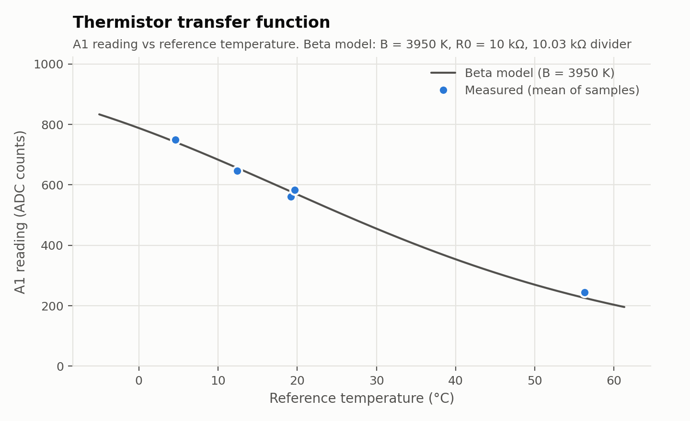
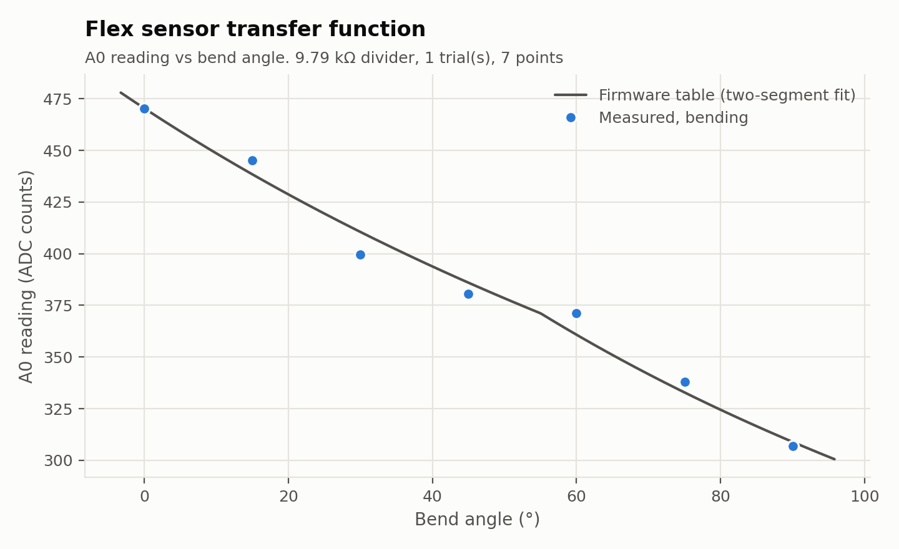
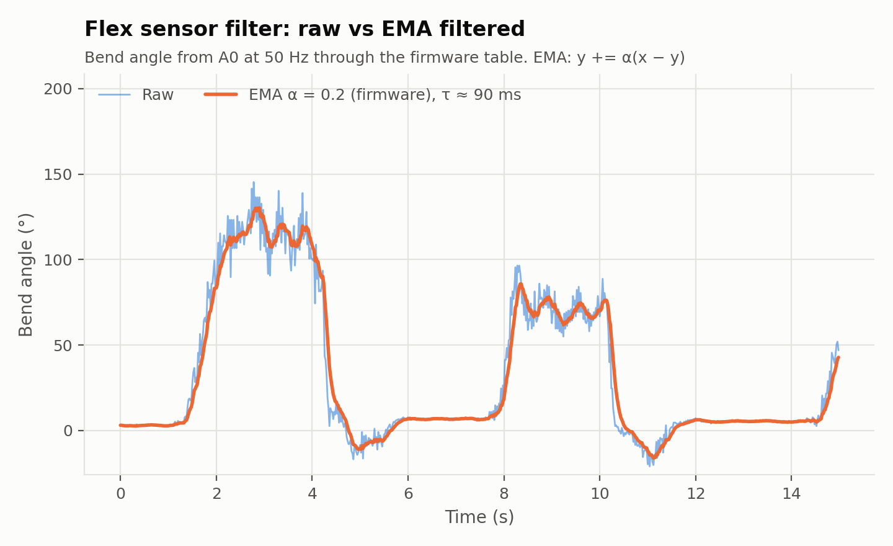

## Calibration Results

Generated by `tools/plot_calibration.py` from `calibration/data` on 2026-11-07. Rerun it after changing any constant in `config.h`; every number below is recomputed from the raw counts.

### Thermistor



| Reference (°C) | ADC counts | Beta model (°C) | Error (°C) |
|---|---|---|---|
| 19.2 | 560.9 ± 0.6 | 20.64 | +1.44 |
| 12.4 | 645.9 ± 0.7 | 13.30 | +0.90 |
| 19.7 | 582.6 ± 0.7 | 18.77 | -0.93 |
| 56.3 | 245.2 ± 0.5 | 53.38 | -2.92 |
| 4.6 | 749.1 ± 0.9 | 3.90 | -0.70 |

Datasheet B = 3950 K: mean error -0.44 °C, max |error| 2.92 °C, RMS 1.60 °C over 5 points.

Best-fit B from this data = 3797 K. Leave-one-out RMS error with a fitted B = 1.95 °C (each point predicted by a B fitted without it, so this is not graded on its own data).

### Flex sensor



| Trial | Direction | Reference (°) | ADC counts | R (kΩ) | Fit (°) | Error (°) |
|---|---|---|---|---|---|---|
| 1 | bend | 0 | 470.2 ± 0.5 | 11.51 | 0.1 | +0.1 |
| 1 | bend | 15 | 445.3 ± 8.5 | 12.70 | 11.6 | -3.4 |
| 1 | bend | 30 | 399.7 ± 9.2 | 15.27 | 36.4 | +6.4 |
| 1 | bend | 45 | 380.7 ± 8.4 | 16.52 | 48.5 | +3.5 |
| 1 | bend | 60 | 371.1 ± 10.3 | 17.19 | 55.0 | -5.0 |
| 1 | bend | 75 | 338.0 ± 7.9 | 19.84 | 72.0 | -3.0 |
| 1 | bend | 90 | 306.8 ± 9.4 | 22.85 | 91.4 | +1.4 |

Fit: two-segment fit of bend angle vs sensor resistance. RMS error 3.8°, max |error| 6.4° over 0 to 90°, leave-one-out RMS 6.4°.

Firmware table (`firmware/tsp05/sensors_analog.cpp`):

```cpp
static const float FLEX_R_OHMS[] = {11500.0f, 17195.0f, 22900.0f};
static const float FLEX_DEG[]    = {-0.00f, 55.01f, 91.72f};
```

### Flex sensor filter



| α | Time constant (ms) | Raw noise (°) | Filtered noise (°) | Noise reduction |
|---|---|---|---|---|
| 0.2 (firmware) | 90 | 2.82 | 0.64 | 77 % |

Noise = standard deviation of the sample-to-sample change while the bend is held steady (424 samples; bend edges and filter settling excluded). The time constant τ = −Δt / ln(1 − α) is the lag the filter adds: less noise costs a slower response.
