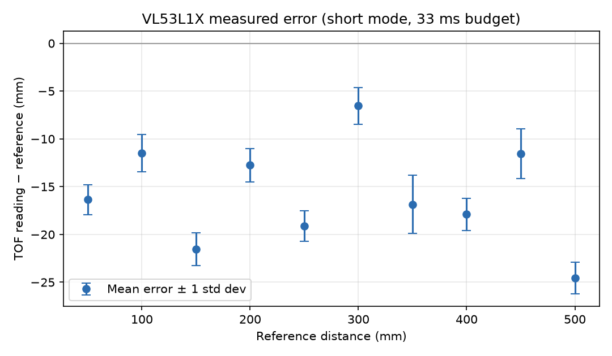
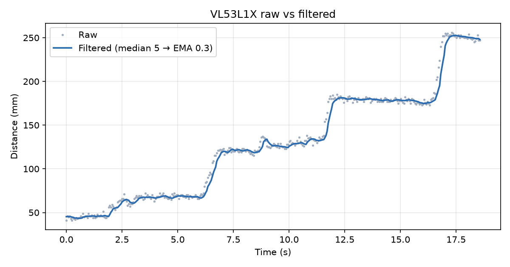

## TOF (VL53L1X) results

Generated by `tools/tof_calibration.py report` from `calibration\data`.

### Measured error

| Reference (mm) | n | Mean reading (mm) | Error (mm) | Std dev (mm) | Error (% of reference) |
|---|---|---|---|---|---|
| 50 | 20 | 33.6 | -16.4 | 1.6 | -32.7 % |
| 100 | 20 | 88.5 | -11.5 | 1.9 | -11.5 % |
| 150 | 20 | 128.4 | -21.6 | 1.7 | -14.4 % |
| 200 | 20 | 187.2 | -12.8 | 1.7 | -6.4 % |
| 250 | 20 | 230.9 | -19.1 | 1.6 | -7.6 % |
| 300 | 20 | 293.4 | -6.6 | 1.9 | -2.2 % |
| 350 | 20 | 333.1 | -16.9 | 3.1 | -4.8 % |
| 400 | 20 | 382.1 | -17.9 | 1.7 | -4.5 % |
| 450 | 20 | 438.4 | -11.6 | 2.6 | -2.6 % |
| 500 | 20 | 475.4 | -24.6 | 1.7 | -4.9 % |

Over 50 to 500 mm: mean error -15.9 mm, RMS error 16.7 mm, max |error| 24.6 mm, worst std dev 3.1 mm. Raw (unfiltered) readings, status-0 only.

With a constant offset correction of +15.9 mm the RMS error would be 5.1 mm.

### Filter: raw vs filtered

| Filter | Raw noise (mm) | Filtered noise (mm) | Noise reduction | Outliers in raw |
|---|---|---|---|---|
| median of 5 → EMA α = 0.3 | 2.10 | 0.31 | 85 % | 0 |

Filtered values: firmware output. Noise = per-sample standard deviation from the sample-to-sample change, robust to the steps where the target moved. Lag cost: the median delays a step by about 2 samples (80 ms) and the EMA adds a time constant τ = −Δt / ln(1 − α) = 112 ms at Δt = 40 ms.

