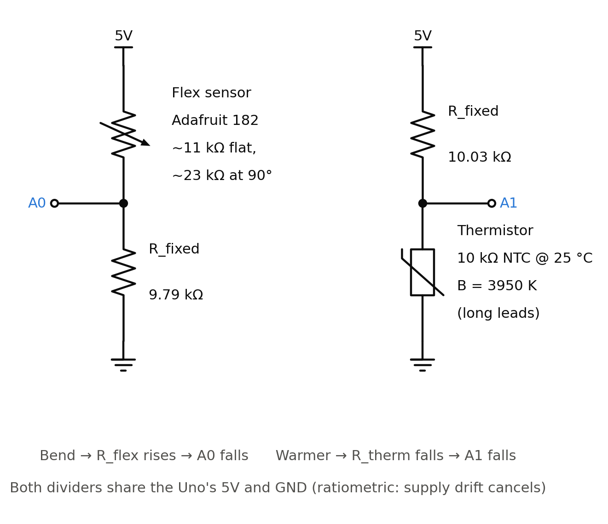

# Pin Map

| Pin | Function | Notes |
|---|---|---|
| D2 | Encoder A | INT0, 4.7k pull-up to 5V |
| D3 | Slot sensor | INT1, 10k pull-up to 5V |
| D4 | Encoder B | Read in encoder ISR, 4.7k pull-up to 5V |
| D5 | L298 enable (PWM) | Timer0 PWM |
| D7 | L298 IN1 | Direction |
| D8 | L298 IN2 | Direction |
| D9 | Servo signal | Servo lib disables PWM on D9/D10 |
| D10 | EasyDriver STEP | |
| D11 | EasyDriver DIR | |
| D12 | EasyDriver ENABLE | Active LOW |
| A0 | Flex sensor divider | 10k to GND |
| A1 | Thermistor divider | 10k to 5V |
| A2 | Pushbutton | INPUT_PULLUP |
| A4 | VL53L1X SDA | |
| A5 | VL53L1X SCL | |

## Power
- DC motor: 12 V bench supply into L298
- Stepper: 12 V bench supply, current limited, into EasyDriver (set pot before connecting motor)
- Servo: separate 5 to 6 V supply
- All supply grounds tied to Arduino GND
- Never wire or unwire while powered

## Stepper wiring (corrected colors)
A = red, C = blue, B = black, D = green

## Analog sensors (Track 4)

Regenerate with `python3 tools/draw_wiring.py` (reads the resistor values from `config.h`).

| Divider | Top | Middle node | Bottom |
|---|---|---|---|
| Flex sensor | 5V → flex sensor (Adafruit 182) | **A0** | 9.79 kΩ → GND |
| Thermistor | 5V → 10.03 kΩ | **A1** | 10 kΩ NTC thermistor → GND |

- Fixed resistors were measured with a multimeter; the values are in `config.h`
  (`FLEX_FIXED_R_OHMS`, `THERM_FIXED_R_OHMS`). Measure again if a resistor is swapped.
- Flex sensor: tape the crimped (pin) end down; it is fragile. Bend only in the
  marked direction; bending the other way barely changes the reading.
- Thermistor: on long leads so the bead can reach a cup of water; keep the legs
  dry (zip-lock bag) during calibration, since water between the legs reads hot.

| Check (Serial Monitor at 115200) | Expected |
|---|---|
| Flex flat / bent 90° | about 470 / about 305 counts |
| Thermistor at 19 °C / pinched | about 583 / drops toward 450 counts |
| Flex unplugged | 0 counts, `flexFault()` true |
| Thermistor unplugged | 1023 counts, `thermistorFault()` true (treat as interlock active) |
